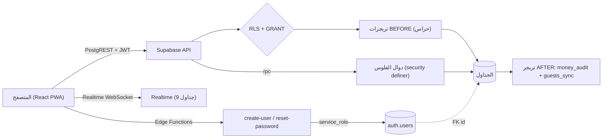
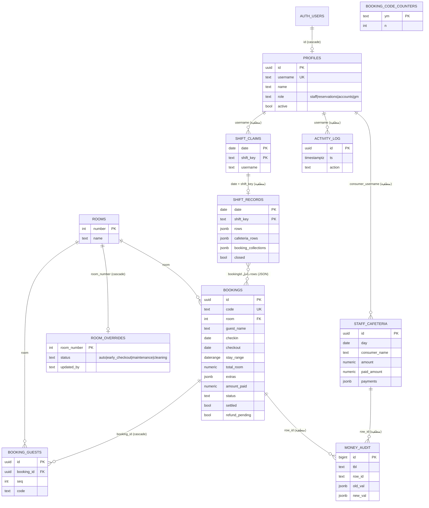
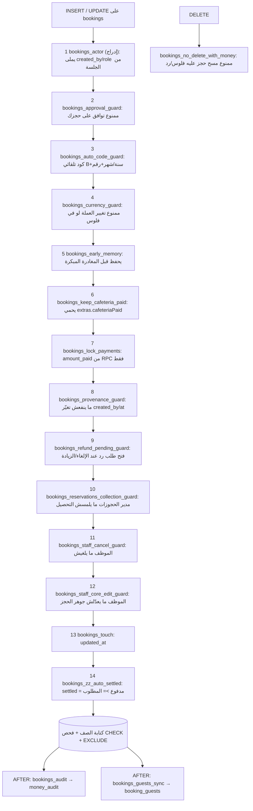
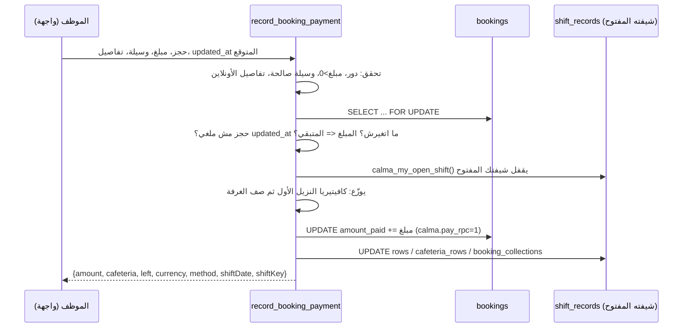
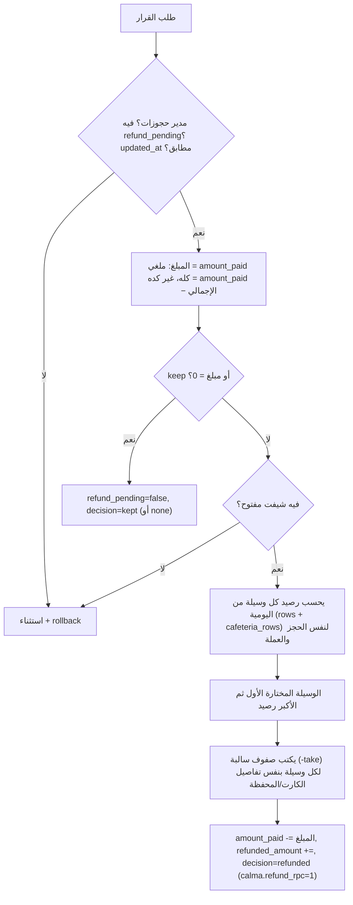
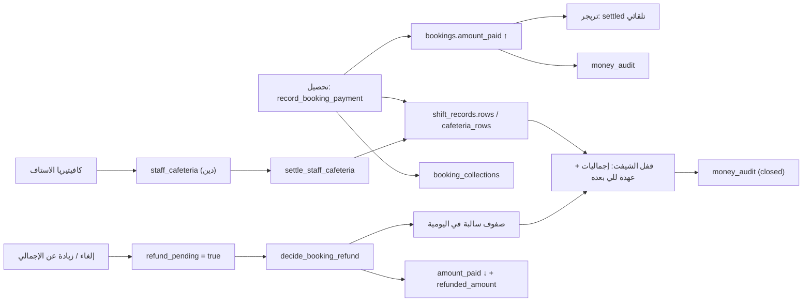

# دليل قاعدة بيانات Calma الكامل

> الملف ده بيشرح قاعدة البيانات (Supabase / PostgreSQL) من الألف للياء: الجداول، العلاقات، الأعمدة، القيود، الصلاحيات (RLS)، التريجرات بترتيبها، دوال الفلوس (RPC)، هياكل الـ JSON، والنسخ الاحتياطي.
> كل المعلومات هنا مستخرجة من قاعدة بيانات حقيقية اتطبّق عليها `supabase/schema.sql` (نسخة المخطط **37**) مش من الذاكرة.
> الدليل المقابل للواجهة: [`SYSTEM_GUIDE.md`](./SYSTEM_GUIDE.md) — الرسومات كصور PNG في [`diagrams/`](./diagrams/).

---

## 0. الصورة الكبيرة

- **11 جدول** في schema `public` + جدول `auth.users` بتاع Supabase (الحسابات الحقيقية).
- **كل جدول عليه RLS** (Row Level Security) — يعني حتى لو حد معاه مفتاح الـ API، القاعدة نفسها هي اللي بتقرر.
- **الفلوس ما بتتغيّرش بكتابة مباشرة**: أي تغيير في `amount_paid` أو ديون كافيتيريا الاستاف بيمر عبر دوال ذرية (`SECURITY DEFINER`) بتكتب الحجز + اليومية في **عملية واحدة** (يا كله يتم يا ولا حاجة).
- **سجل تدقيق على مستوى القاعدة** (`money_audit`) بيتكتب بتريجر — مهما كان الطريق (واجهة، API مباشر، محرر SQL).
- **رقم نسخة المخطط** `calma_schema_version()` = 37؛ الواجهة بتقارنه بـ `REQUIRED_SCHEMA_VERSION` وتظهر لافتة تحذير لو القاعدة لسه ما اتحدّثتش.



---

## 1. خريطة العلاقات (ERD)



**ملاحظة مهمة:** العلاقات اللي مكتوب جنبها "منطقية" مفيش عليها Foreign Key فعلي — الربط بالاسم (`username`) أو بالتاريخ والشيفت. الـ FK الحقيقية: `profiles.id→auth.users`، `bookings.room→rooms`، `booking_guests.booking_id→bookings`، `booking_guests.room→rooms`، `room_overrides.room_number→rooms`.

---

## 2. الجداول واحد واحد

### 2.1 `profiles` — المستخدمين وأدوارهم
| العمود | النوع | ملاحظات |
|---|---|---|
| `id` | uuid PK | = `auth.users.id` (FK، حذف المستخدم يمسح البروفايل) |
| `username` | text UNIQUE | حد أقصى 30 حرف |
| `name` | text | حد أقصى 80 حرف |
| `role` | text | `staff` / `reservations` / `accounts` / `gm` |
| `active` | bool | افتراضي true — الحساب المعطّل مش بيشوف حاجة (`is_active_user()`) |
| `created_at` | timestamptz | |

**من يكتب:** الإدراج للمدير العام فقط، **إلا** أول حساب في النظام (لو `profiles_exist()` = false يقدر ينشئ نفسه `gm`). التعديل للمدير العام فقط.
**حراس:** `profiles_protect_identity` (ما ينفعش تغيّر id/username بسهولة)، `profiles_protect_last_gm` (ما ينفعش تعطّل/تنزّل آخر مدير عام نشط)، `profiles_audit`.

### 2.2 `rooms` — الغرف
`number` (int PK)، `name`. كتابة (إضافة/تعديل/مسح) لمدير الحجوزات `is_reservations_manager()`. قراءة لأي مستخدم نشط.

### 2.3 `room_overrides` — حالة الغرفة اليدوية
غرفة واحدة = صف واحد (`room_number` PK). `status` ∈ `auto` / `early_checkout` / `maintenance` / `cleaning`. `updated_by` بيتملى تلقائيًا من `set_actor_fields`. الكتابة لموظف الشيفت أو مدير الحجوزات.

### 2.4 `bookings` — الحجوزات (قلب النظام)
| الفئة | الأعمدة |
|---|---|
| هوية | `id`، `code` (فريد جزئيًا حيث ليس null)، `room` (FK→rooms) |
| النزيل | `guest_name` (≤200)، `phone` (≤60)، `pax` (1–100)، `guest_codes` (jsonb array ≤100 عنصر) |
| التواريخ | `checkin`، `checkout`، `stay_range` (daterange `[)` للتعارض) |
| الأسعار | `price_night`، `total_room`، `extras` (jsonb)، `early_checkin` (jsonb)، `currency` |
| الدفع | `payment_method`، `payment_details` (jsonb)، `amount_paid`، `amount_tendered`، `settled` |
| الحالة | `status`، `approval_status` (`approved`/`pending`)، `source`، `notes` (≤2000) |
| الرد | `refund_pending`، `refunded_amount`، `refunded_by`، `refunded_at`، `refund_decision` (`refunded`/`kept`) |
| مغادرة مبكرة | `left_early`، `pre_early_checkout`، `pre_early_total` |
| علامات | `imported`، `needs_room_review`، `duplicate_placement` |
| أثر | `created_by`، `created_by_role`، `created_at`، `updated_at` |

**القيود (CHECK / EXCLUDE):**
- `currency` ∈ EGP/USD/EUR/SAR/GBP.
- `status` ∈ مؤكد / تم تسجيل الدخول / تم تسجيل الخروج / ملغي.
- `source` ∈ مباشر / سوشيال ميديا / Booking.com / Expedia / Trip.com.
- التواريخ: `checkout > checkin` **أو** (`checkout = checkin` و`left_early = true`).
- المبالغ ≥ 0 و≤ مليار؛ `pax > 0`؛ `extras` لازم فيه `laundry,cafeteria,tours,pickup` وقيمهم ≥ 0؛ `early_checkin` لازم `applied,fee,note` والرسوم ≥ 0؛ `payment_details` لازم `senderName,senderNumber,ref`.
- حدود حجم الـ JSON (4000/2000/2000 بايت) وطول النصوص.
- **`bookings_no_overlap`**: `EXCLUDE USING gist (room WITH =, stay_range WITH &&) WHERE (status <> 'ملغي')` — **ممنوع حجزين متداخلين لنفس الغرفة** (الملغي مستثنى). مفيش طريقة لتجاوزه حتى من الـ API.

**الفهارس:** `bookings_pkey`، `bookings_code_idx`، `bookings_code_unique_idx` (code فريد لو مش null)، `bookings_room_dates_idx (room, checkin, checkout)`، `bookings_no_overlap` (gist).

### 2.5 `booking_guests` — أفراد الحجز (أكواد النزلاء)
مشتقة من `bookings.pax + guest_codes` بتريجر (`bookings_guests_sync`) — **للقراءة فقط** من الـ API (`authenticated` معاه SELECT بس). `seq` (>0) وفريد مع `booking_id`. `ym` = شهر الدخول للبحث بالكود.

### 2.6 `booking_code_counters` — عدّاد أكواد الحجز
`ym` (مثال `2610`) و`n`. الدالة `next_booking_code(day)` بتزوّد العدّاد بقفل وتطلع كود بصيغة `B2610-0001`. بعد 9999 في الشهر الرقم بيطول ولا بيتقصّ (إصلاح قسم 32).

### 2.7 `shift_claims` — اختيار الشيفت
مفتاح `(date, shift_key)` + قيد فريد `(date, username)` ← **موظف واحد لكل شيفت، وشيفت واحد للموظف في اليوم**. الإدراج لموظف الشيفت وفي نطاق اليوم الحالي ±1؛ التعديل/المسح للمدير العام.

### 2.8 `shift_records` — اليومية (صف لكل شيفت)
مفتاح `(date, shift_key)`، `shift_key` ∈ morning/evening/night.
| العمود | المعنى |
|---|---|
| `staff_name`, `staff_username` | صاحب الشيفت |
| `handover` | عهدة مستلمة `{EGP,USD,...}` |
| `method_handover` | عهدة لكل وسيلة دفع |
| `rows` | صفوف اليومية (تحصيل/مصروف لكل غرفة) — الأكبر (≤1MB) |
| `hotel_rows` | مصاريف/إيرادات الفندق العامة |
| `cafeteria` | بيانات كافيتيريا قديمة (≤50KB) |
| `cafeteria_rows` | تحصيل الكافيتيريا التلقائي (نزلاء + استاف) |
| `booking_collections` | مراجع `{id, bookingId}` لكل تحصيل اتسجل |
| `shift_notes`, `flagged` | ملاحظات وعلامة مراجعة |
| `closed`, `closed_by`, `closed_at` | القفل |
| `total_expenses`, `total_collections`, `closing_cash`, `cash_collections`, `by_method_currency`, `by_category`, `method_closing` | لقطة إجماليات تتحسب وقت القفل |
| `updated_at` | |

### 2.9 `staff_cafeteria` — استهلاك الاستاف ومديونياتهم
`id`، `day` (افتراضي `hotel_today()`)، `shift_key`، `consumer_username` (اختياري)، `consumer_name` (1–120)، `description` (≤300)، `amount` (>0 و≤1,000,000)، `currency`، `paid_amount` (0..amount)، `payments` (jsonb array ≤20KB)، `recorded_by`. المديونية = `amount − paid_amount` وتفضل عبر الشيفتات لحد السداد.

### 2.10 `activity_log` — سجل الحركة (من الواجهة)
`id`، `ts`، `user_name`/`username`/`role` (بيتملوا تلقائيًا من الجلسة)، `action` (≤2000). **إدراج فقط** (مفيش تعديل ولا مسح من الـ API). القراءة لـ `can_view_activity_log()` أو صاحب السجل.

### 2.11 `money_audit` — سجل التدقيق على مستوى القاعدة
`id` (identity)، `ts`، `actor`، `tbl`، `row_id`، `action` (insert/update/delete)، `old_val`، `new_val` (jsonb للأعمدة الحساسة بس). **قراءة فقط** للمدير العام / الحسابات / مدير الحجوزات. بيتكتب بالتريجر `calma_audit()` — ولا مستخدم يقدر يكتب أو يمسح منه.

| الجدول المراقَب | الأعمدة اللي بتتسجل |
|---|---|
| bookings | amount_paid, status, refund_pending, refund_decision, settled, currency, total_room, price_night, checkin, checkout, room |
| staff_cafeteria | amount, paid_amount, consumer_name, currency |
| profiles | username, role, active |
| shift_records | closed, closed_by, date, shift_key, staff_username, total_collections, closing_cash (عند تغيّر `closed` + عند الحذف) |

القاعدة: التحديث اللي مبيغيّرش أي عمود مراقَب مش بيتسجل؛ إدراج حجز/دين بصفر مدفوع مش بيتسجل.

---

## 3. هياكل الـ JSON

```text
bookings.extras           { laundry, cafeteria, tours, pickup, cafeteriaPaid? }
                          cafeteriaPaid = اللي اتحصّل من كافيتيريا النزيل (بيتغيّر من record_booking_payment فقط)
bookings.early_checkin    { applied:boolean, fee:number, note:string }
bookings.payment_details  { senderName, senderNumber, ref, onlinePaid?:boolean }
bookings.guest_codes      [ "كود1", "كود2", ... ]   (≤100)

shift_records.rows[] (صف يومية)
  { room, bookingId?, expenseDesc, expenseAmt, expenseCategory, expenseCurrency,
    collectionDesc, collectionAmt, collectionMethod, collectionCurrency,
    paymentDetails:{senderName,senderNumber,ref,onlinePaid}, notes }
shift_records.cafeteria_rows[]  نفس الشكل + kind:'guest'|'staff' + key + who
shift_records.booking_collections[]  { id, bookingId }

staff_cafeteria.payments[]
  { id, at(ms), amount, method, details, day, shiftKey }
```

> الرد على نزيل بيتسجّل في الصف بـ `collectionAmt` **سالب**، والدفعات بتتجمّع على نفس الصف (وسيلة + عملة + تفاصيل الأونلاين) بدل صف جديد كل مرة.

---

## 4. الصلاحيات

### 4.1 الأدوار والدوال المساعدة
| الدالة | بترجع true لو |
|---|---|
| `is_active_user()` | المستخدم له بروفايل `active=true` |
| `is_staff()` | الدور `staff` وحسابه نشط |
| `is_reservations_manager()` | الدور `reservations` |
| `is_staff_or_reservations()` | أي من الاتنين |
| `can_manage_financials()` | `gm` أو `accounts` |
| `is_gm()` | `gm` |
| `is_gm_or_reservations()` | `gm` أو `reservations` |
| `can_view_activity_log()` | أدوار الإدارة |
| `is_next_shift_claimant(date, shift)` | الموظف اللي حاجز الشيفت اللي بعد ده |
| `profiles_exist()` | في أي بروفايل أصلاً (لإنشاء أول مدير) |
| `hotel_today()` | تاريخ النهارده بتوقيت `Africa/Cairo` |

### 4.2 سياسات RLS (26 سياسة)
| الجدول | قراءة | إضافة | تعديل | مسح |
|---|---|---|---|---|
| profiles | نشط | أول gm أو gm | gm | — |
| rooms | نشط | reservations | reservations | reservations |
| room_overrides | نشط | staff/reservations | staff/reservations | staff/reservations |
| bookings | نشط | staff/reservations | staff/reservations | reservations |
| booking_guests | نشط | — (ممنوع) | — | — |
| shift_claims | نشط | staff + تاريخ ±1 | gm | gm |
| shift_records | نشط | staff + ±1 + عنده claim للشيفت ده | صاحبه، أو (مفتوح + مستلم الشيفت اللي بعده)، أو (مقفول + gm/accounts/reservations) | gm وهو مفتوح |
| staff_cafeteria | نشط | staff | staff أو financials | financials |
| activity_log | can_view أو صاحب السجل | أي نشط | — | — |
| money_audit | gm / financials / reservations | — | — | — |

### 4.3 الـ GRANT على مستوى الجدول
- `authenticated`: DML كامل على الجداول العادية — لكن **SELECT فقط** على `booking_guests` و`money_audit`، و**SELECT + INSERT** على `activity_log`.
- `service_role`: كل شيء (للـ Edge Functions).
- `anon`: مفيش وصول للبيانات.
- دوال الحراسة الداخلية (`calma_audit`, `calma_my_open_shift`, `bookings_auto_code`, `bookings_sync_guests`) **مسحوب منها التنفيذ** من الجميع.
- دوال الفلوس (`record_booking_payment`, `decide_booking_refund`, `record_staff_cafeteria`, `settle_staff_cafeteria`) بتتنفّذ لـ `authenticated` فقط، وكل واحدة بتتحقق من الدور جوّاها.

---

## 5. التريجرات وترتيبها

Postgres بينفّذ تريجرات نفس الحدث **بالترتيب الأبجدي للاسم**. ده سبب تسمية `zz_auto_settled` (لازم يشتغل آخر واحد).

### 5.1 `bookings`


| التريجر | الدالة | بيعمل إيه |
|---|---|---|
| `bookings_actor` | `set_actor_fields` | يملى `created_by`/`created_by_role` من الجلسة بدل ما العميل يكتبها |
| `bookings_approval_guard` | `prevent_self_approval` | لا تغيّر `approval_status` من pending لـ approved على حجز أنت عملته |
| `bookings_auto_code_guard` | `bookings_auto_code` | يولّد الكود ويمنع تغييره/تزويره |
| `bookings_currency_guard` | `prevent_currency_change_when_paid` | ممنوع تغيير العملة لو `amount_paid` أو `refunded_amount` ≠ 0 |
| `bookings_early_memory` | `remember_pre_early_leave` | يحفظ `pre_early_checkout/total` عند أول مغادرة مبكرة |
| `bookings_keep_cafeteria_paid` | `keep_cafeteria_paid` | يرجّع `extras.cafeteriaPaid` لقيمته القديمة لو اتغيّر من خارج RPC |
| `bookings_lock_payments` | `lock_booking_payments` | من جلسة حقيقية: `amount_paid` ما يتغيّرش (ولا يتحط وقت الإنشاء) إلا من RPC |
| `bookings_provenance_guard` | `protect_record_provenance` | حماية أثر الإنشاء |
| `bookings_refund_pending_guard` | `set_refund_pending_on_cancel` | لو اتلغى حجز عليه مدفوع أو المدفوع زاد عن الإجمالي → `refund_pending=true` |
| `bookings_reservations_collection_guard` | `prevent_reservations_collection_edit` | مدير الحجوزات ممنوع يغيّر `amount_paid`/`amount_tendered` (إلا من RPC الرد) |
| `bookings_staff_cancel_guard` | `prevent_staff_cancel_status` | موظف الشيفت ما يحطش `ملغي` |
| `bookings_staff_core_edit_guard` | `prevent_staff_core_booking_edit` | الموظف يعدّل حقول محدودة بس |
| `bookings_touch` | `touch_updated_at` | `updated_at = now()` (أساس فحص "الحجز اتغيّر من حد تاني") |
| `bookings_zz_auto_settled` | `bookings_auto_settled` | `settled = (status ≠ ملغي) AND (amount_paid ≥ booking_hotel_total)` |
| `bookings_audit` | `calma_audit` | يسجّل في `money_audit` |
| `bookings_guests_sync` | `bookings_sync_guests` | يعيد بناء `booking_guests` عند تغيّر pax/room/guest_codes/checkin |
| `bookings_no_delete_with_money` | `prevent_delete_booking_with_money` | يمنع المسح لو مدفوع/رد معلّق/مردود/مدفوع أونلاين — استخدم "ملغي" |

**تجاوز الحراس:** حراس الفلوس (`lock_booking_payments`, `keep_cafeteria_paid`, `lock_staff_cafeteria_money`, `prevent_*_collection*`) بيعدّوا لو `auth.uid() is null` — يعني **محرر SQL / صيانة** (مفيش مستخدم). الواجهة والـ API دايمًا فيهم مستخدم، فمفيش تجاوز.

### 5.2 باقي الجداول
| الجدول | التريجرات |
|---|---|
| `profiles` | `profiles_protect_identity` ، `profiles_protect_last_gm`، `profiles_audit` |
| `room_overrides` | `room_overrides_actor` (يملى `updated_by`) |
| `shift_claims` | `shift_claims_actor` |
| `shift_records` | `actor` (إدراج)، `claimant_guard` (غير صاحب الشيفت يقفل بس، ما يمسحش صفوف)، `lock` = `prevent_closed_shift_edit` (المقفول: إعادة فتح للـ gm/reservations، وتعديل محتواه للـ gm/accounts)، `provenance_guard`، `touch`، `audit` (عند تغيّر closed)، `audit_del` |
| `staff_cafeteria` | `guard_trg` (`staff_cafeteria_guard`)، `lock_money` (المبلغ/المدفوع/الدفعات من RPC فقط)، `audit` |
| `activity_log` | `activity_log_actor` (يملى الاسم/الدور) |

---

## 6. دوال الفلوس (RPC)

كلها `SECURITY DEFINER` + `search_path = public`، وكل واحدة بتتنفّذ **كلها أو ولا حاجة** (استثناء = rollback).

### 6.1 `record_booking_payment(p_booking, p_amount, p_method, p_details, p_expected, p_note)`
**من يستدعيها:** موظف الشيفت فقط (`is_staff()`).

رسائل الرفض: "مفيش شيفتك مفتوح…"، "المبلغ أكبر من المتبقي على النزيل (X)"، "الحجز اتغيّر من حد تاني…"، "الحجز ملغي…".
المتبقي = `booking_hotel_total − amount_paid`.

### 6.2 `decide_booking_refund(p_booking, p_decision, p_expected, p_method)`
**من يستدعيها:** مدير الحجوزات فقط. `p_decision` = `refund` أو `keep`.

القاعدة: لو الوسيلة المختارة ملهاش رصيد في اليومية، الرد كله عليها (قرار المدير). لو المدفوع أكبر من المسجل في اليومية (بيانات قديمة) الفرق بيتحسب على أول وسيلة.

### 6.3 `record_staff_cafeteria(p_name, p_username, p_desc, p_amount, p_currency, p_method, p_details)`
موظف الشيفت. لو `p_method` فاضي = دين (آجل)، ولو موجود = مدفوع فورًا (وبيتسجّل صف تحصيل في `cafeteria_rows`). الحد 1,000,000، العملات الخمس.

### 6.4 `settle_staff_cafeteria(p_name, p_username, p_currency, p_amount, p_method, p_details)`
سداد دين استاف. بيقفل صفوف المديونية بترتيب `created_at` ثم يوزّع المبلغ **الأقدم أولًا**. الرفض: "مفيش مديونية"، "المبلغ أكبر من المديونية (X)". المفتاح `k` = `consumer_username` أو الاسم بحروف صغيرة.

### 6.5 دوال مساعدة
| الدالة | الوظيفة |
|---|---|
| `calma_my_open_shift()` | آخر شيفت مفتوح للموظف (اليوم/أمس) بقفل `FOR UPDATE`؛ وإلا "مفيش شيفتك مفتوح" |
| `calma_valid_method(m)` | هل وسيلة الدفع من القائمة المعتمدة |
| `calma_online_method(m)` | هل وسيلة أونلاين (فيزا/تحويل/فودافون/انستاباي) |
| `calma_details_err/key/clean_details/last4/phone` | التحقق من تفاصيل الوسيلة (آخر 4 أرقام للفيزا، اسم+رقم للمحافظ) وتنظيفها |
| `calma_num(text)` | تحويل نص لرقم بتسامح (`.5`, `1e3`)، غير الصالح = 0 |
| `calma_apply_room_collection(...)` | يضيف/يدمج تحصيل في صف الغرفة بـ `rows` |
| `calma_apply_cafe_collection(...)` | نفس الشيء لـ `cafeteria_rows` |
| `booking_grand_total(b)` | `total_room + laundry + cafeteria + tours + pickup + (early.fee لو applied)` |
| `booking_hotel_total(b)` | الإجمالي؛ ولو `onlinePaid` = الإجمالي − `total_room` (سعر الغرفة اتدفع للمنصة) |
| `reprice_total(b, new_checkout)` | إعادة حساب سعر الغرفة عند تغيير الخروج |
| `next_booking_code(day)` | كود الحجز التالي |
| `calma_schema_version()` | **37** |

### 6.6 أعلام الجلسة (transaction-local)
| العلم | بيتحط من | بيسمح بإيه |
|---|---|---|
| `calma.pay_rpc = 1` | `record_booking_payment` | تغيير `amount_paid` و`extras.cafeteriaPaid` |
| `calma.refund_rpc = 1` | `decide_booking_refund` | تغيير `amount_paid`/الرد لمدير الحجوزات |
| `calma.staff_rpc = 1` | `record/settle_staff_cafeteria` | تغيير مبلغ/مدفوع/دفعات الاستاف |

الأعلام `set_config(..., true)` يعني **داخل المعاملة فقط**، وبتتصفّر قبل الخروج.

---

## 7. رحلة الفلوس من الأول للآخر



**مطابقة الأرقام:** `supabase/ops/reconcile.sql` بيقارن `amount_paid` على كل حجز بمجموع تحصيله في اليومية ويكشف أي فرق (و`reconcile_before.sql` للمقارنة قبل التحديث). بعد أي صيانة يدوية من محرر SQL شغّله.

---

## 8. البث اللحظي (Realtime)

Publication `supabase_realtime` فيها 9 جداول: profiles، rooms، room_overrides، bookings، shift_records، shift_claims، activity_log، booking_guests، staff_cafeteria. (`money_audit` و`booking_code_counters` مش منشورين.) الواجهة بتفتح قناة على 7 جداول أساسية + `staff_cafeteria` اختياريًا؛ كل تغيير بيرفع `dataVersion` وبيتعمل إعادة جلب. الـ RLS بيتطبق على البث كمان (لازم "Realtime Authorization" يكون مفعّل).

---

## 9. هيكل ملف `schema.sql` (الأقسام)

الملف **idempotent** (ينفع يتشغّل أكتر من مرة) ومقسّم أقسام مرقّمة؛ لازم يتطبّق كله بالترتيب.
| الأقسام | المحتوى |
|---|---|
| 0–9 | الدوال العامة، profiles، rooms، room_overrides، bookings، shift_records، shift_claims، activity_log، realtime، تنفيذ الدوال |
| 1–13 (الطبقة الثانية) | GRANT، تحصين search_path، حماية آخر gm، actor، قفل الشيفت المقفول، منع الموافقة الذاتية، قيود السلامة، منع التعارض، تشديد RLS |
| 14–17 | قرارات مدير الحجوزات، صلاحيات staff، إعادة فتح الشيفت |
| 18–28 | أعمدة إضافية، العملات والمصادر، رد الفلوس، المغادرة المبكرة، الأكواد، صفوف الفندق |
| 29–32 | الكود التلقائي، `settled` تلقائي، كافيتيريا، تقسيم الرد على الوسائل، إصلاح كود >9999 |
| 33 | RPC الذرية (دفع/استاف) |
| 34–35 | تقوية بعد المراجعة، قفل الكتابة المباشرة على الفلوس |
| 36–37 | نسخة المخطط، `shift_records_claimant_guard`، `money_audit` |

**تحديث الإنتاج:** افتح SQL Editor في Supabase، الصق `schema.sql` كله وشغّله، ثم تأكد: `select calma_schema_version();` ← يرجع **37**. لو أقل، الواجهة تعرض `SchemaOutdatedBanner`.

---

## 10. النسخ الاحتياطي والاستعادة

مفصّلة في [`BACKUP.md`](./BACKUP.md). الخلاصة:
1. النسخ: `pg_dump` (يشمل الجداول + البيانات).
2. الاستعادة على قاعدة جديدة: تجهيز stub لـ `auth` → `schema.sql` → `truncate table public.rooms cascade;` (عشان الغرف المزروعة) → استعادة بيانات فقط.
3. التمرين الآلي: `node scripts/dr-drill.mjs` (بيتشغّل في CI) بيعمل الدورة كاملة ويقارن الأرقام. **تمرين الاستعادة على Supabase الحقيقي لسه NOT VERIFIED** (محتاج بيئة staging — انظر `RELEASE_CERTIFICATION.md`).

---

## 11. افتح قاعدة فاضية: إزاي أفضّي البيانات؟

- المسح من لوحة Supabase (Table Editor) هيفشل على حجز عليه فلوس بسبب `prevent_delete_booking_with_money` — ده مقصود.
- التفضية من **SQL Editor** (مفيش مستخدم، `auth.uid()` فاضي) بتعدّي الحراس:
```sql
-- بيانات تشغيلية فقط، وبيسيب الغرف والمستخدمين
truncate table public.booking_guests, public.bookings, public.shift_records,
  public.shift_claims, public.staff_cafeteria, public.activity_log,
  public.money_audit, public.booking_code_counters, public.room_overrides;
```
> `TRUNCATE` ما بيشغّلش تريجرات الصف، فمفيش مدخلات تدقيق جديدة بتتولّد. اعمل نسخة احتياطية قبلها.

---

## 12. حدود معروفة على مستوى القاعدة

| # | الحد | الأثر |
|---|---|---|
| 1 | قفل سعر مدير الحجوزات (بعد الدفع) بيمنع تغيير `amount_paid` بس؛ تغيير `total_room` اللي بعد الدفع **قفله في الواجهة** مش في القاعدة | مدير الحجوزات بـ API مباشر يقدر يغيّر السعر (يتسجّل في `money_audit`) |
| 2 | الإقفال التلقائي للشيفت بعد المهلة **مبني على ساعة الجهاز** عند فتح اليومية | لو مفيش حد فتح اليومية الشيفت يفضل مفتوح |
| 3 | `reset-password` مش بتنهي الجلسات الشغالة للمستخدم | الجلسة القديمة تفضل لحد انتهاء التوكن |
| 4 | إعادة محاولة تسجيل استهلاك استاف بعد انقطاع الشبكة ممكن تسجّل مرتين (مفيش مفتاح idempotency) | يتكشف من مراجعة `staff_cafeteria` |
| 5 | الحراس بتتعدّى من محرر SQL | صلاحية الدخول للـ SQL Editor = صلاحية مالك المشروع |
| 6 | تسجيل الاشتراك العام (Public sign-up) في Supabase Auth لازم يتقفل يدويًا | **BLOCKED** — إجراء من المالك |
| 7 | Edge Functions و Auth الحقيقي لم تُختبر على Supabase الحقيقي | **NOT VERIFIED** |

> القرار الحالي في شهادة الإصدار: **NO-GO** لحد قفل البنود المفتوحة (انظر `RELEASE_CERTIFICATION.md`).

---

## 13. مراجع الاختبار

| ما يتم اختباره | الأمر | العدد |
|---|---|---|
| قاعدة بيانات (SQL حقيقي) | `bash supabase/tests/run.sh` | 348 فحص |
| API فعلي (PostgREST) | `npm run test:api` | — |
| محاكاة سيناريوهات | `vitest.sim.config.js` | 68 |
| وحدات | `npm test` | 213 |
| متصفح كامل | Playwright e2e | 162 |
| تمرين استعادة | `node scripts/dr-drill.mjs` | — |
