# دليل النظام الكامل — من أول ضغطة لآخر حاجة

> دليل مكتوب من الكود الفعلي (واجهة React + دوال قاعدة البيانات)، مش من الذاكرة. كل جملة هنا ليها مصدر في الكود، واللي مش مؤكد بنقوله صراحة.
> الدليل المقابل للقاعدة: [`DATABASE_GUIDE.md`](./DATABASE_GUIDE.md). الدياجرامات بتتعرض تلقائيًا على GitHub، ونسخة صور PNG منها في [`diagrams/`](./diagrams/).

## فهرس

0. [إزاي تقرا الدليل](#0-إزاي-تقرا-الدليل)
1. [الصورة الكبيرة](#1-الصورة-الكبيرة)
2. [أول ما تفتح الموقع](#2-أول-ما-تفتح-الموقع)
3. [الأدوار والتابات والصلاحيات](#3-الأدوار-والتابات-والصلاحيات)
4. [الهيدر وتسجيل الخروج](#4-الهيدر-وتسجيل-الخروج)
5. [كل شاشة بالتفصيل](#5-كل-شاشة-بالتفصيل)
6. [السيناريوهات من الأول للآخر](#6-السيناريوهات-من-الأول-للآخر)
7. [الحسابات والقواعد المالية](#7-الحسابات-والقواعد-المالية)
8. [المزامنة والشبكة والأعطال](#8-المزامنة-والشبكة-والأعطال)
9. [رسائل الخطأ الشائعة](#9-رسائل-الخطأ-الشائعة)
10. [حدود معروفة](#10-حدود-معروفة)
11. [ملحق: ضغطة ← طلب ← جدول](#11-ملحق-ضغطة--طلب--جدول)

---

## 0) إزاي تقرا الدليل

- **«واجهة»** = اللي بيحصل في المتصفح (كود في `src/`). **«قاعدة»** = اللي بيتنفّذ جوه Postgres (`supabase/schema.sql`) ومش بيتجاوز مهما حاولت من الواجهة.
- القاعدة هي **الحكم النهائي**: لو الواجهة سمحت بحاجة والقاعدة رفضتها، الرفض هو اللي بيحصل (وبتظهر رسالته بالعربي).
- الفلوس بتتسجل بـ **دوال ذرية** في القاعدة (كله أو ولا حاجة): `record_booking_payment` و`decide_booking_refund` و`record_staff_cafeteria` و`settle_staff_cafeteria`.
- «يوم الشيفتات» بيبدأ ٨ الصبح ويكمل لحد ٨ الصبح اللي بعده (الشيفت الليلي بيتسجل على يوم المسائي اللي قبله).

---

## 1) الصورة الكبيرة

النظام تطبيق ويب (PWA) بيشتغل في المتصفح، ومفيش سيرفر خاص بينا: كل حاجة بتتكلم مع Supabase.

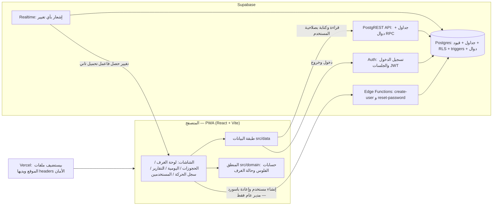

**فين بيحصل إيه:**

| الطبقة | بتعمل إيه | مثال |
|---|---|---|
| الواجهة | تعرض، تتحقق مبدئيًا (عشان رسالة سريعة)، تنادي القاعدة | «المبلغ أكبر من المتبقي» قبل ما تبعت |
| القاعدة | **تفرض** القواعد: الصلاحيات، منع الحجز المزدوج، قفل الفلوس، الحالة التلقائية، التدقيق | `lock_booking_payments` يمنع تعديل `amount_paid` يدويًا |
| Edge Functions | الحاجات اللي محتاجة مفتاح `service_role`: إنشاء حساب دخول وإعادة تعيين باسورد | مدير عام فقط، وفيها حد للطلبات (best-effort) |
| Vercel | استضافة + headers (HTTPS، CSP، منع الـ iframe) | `vercel.json` |

---

## 2) أول ما تفتح الموقع

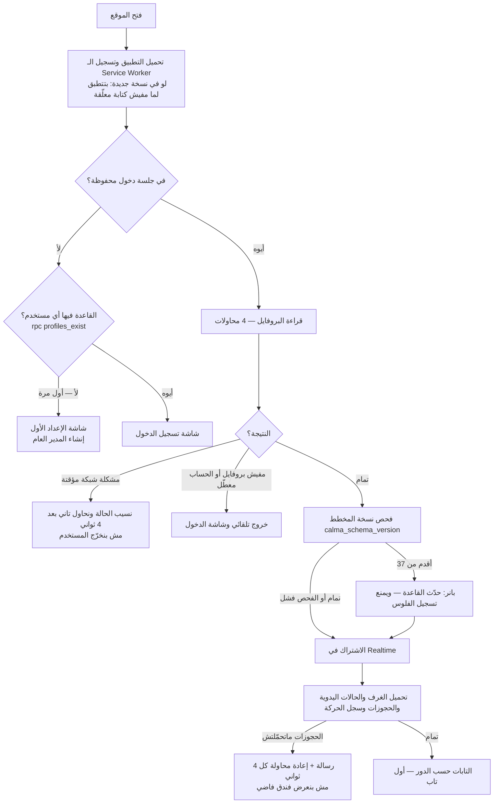

**تفاصيل مهمة:**

- **الإعداد الأول:** لو القاعدة مفيهاش ولا مستخدم، بتظهر شاشة «الإعداد الأول — إنشاء حساب المدير العام» (الاسم، اسم المستخدم، كلمة المرور مرتين). السماح ده في القاعدة بيحصل **مرة واحدة بس** (policy `profiles insert`: دور `gm` فعّال و`profiles_exist() = false`). بعد كده ماحدش يقدر يعمل حساب من هنا.
- **تسجيل الدخول:** اسم المستخدم بيتحوّل داخليًا لإيميل `اسم@calma.internal`. مفيش «نسيت الباسورد» ولا «حساب جديد» — المدير العام هو اللي بيعمل الحسابات. لو الدخول نجح لكن الحساب معطّل أو من غير بروفايل، الزرار بيرجع بعد 6 ثواني برسالة «تعذر الدخول - الحساب ممكن يكون معطّل أو بياناته ناقصة».
- **كلمة المرور:** 8 حروف على الأقل، فيها حرف ورقم، وأقصاها 128. اسم المستخدم: 3–30 حرف إنجليزي/أرقام/`_`.
- **فحص نسخة المخطط:** لو القاعدة أقدم من المطلوب (دلوقتي 37) بيظهر بانر أحمر في أول الصفحة، وأي عملية فلوس بترجع رسالة «قاعدة البيانات لسه ماتحدّثتش» بدل خطأ تقني.
- **التحميل:** الحجوزات بتتقرا بصفحات (1000 صف في المرة) عشان Supabase بيقص عند 1000 بصمت. أي قراءة فشلت بتسيب آخر بيانات سليمة بدل ما تفضّي الشاشة.
- لو المستخدم اتغيّر على نفس الجهاز (خروج/دخول بحساب تاني) كل البيانات بتتفضّى الأول عشان مستخدم ما يشوفش بيانات اللي قبله.

---

## 3) الأدوار والتابات والصلاحيات

أربع أدوار بس (`profiles.role`): **موظف الشيفت** `staff`، **مدير الحجوزات** `reservations`، **مديرة الحسابات** `accounts`، **المدير العام** `gm`.

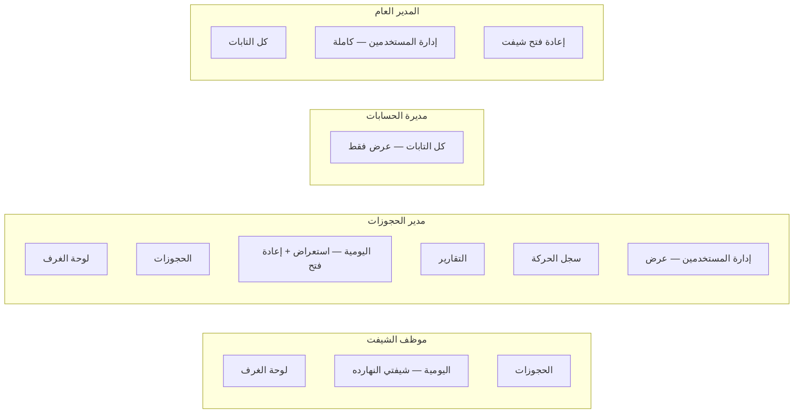

### مصفوفة الصلاحيات (واجهة + قاعدة)

| العملية | موظف الشيفت | مدير الحجوزات | مديرة الحسابات | المدير العام |
|---|:-:|:-:|:-:|:-:|
| يشوف لوحة الغرف والحجوزات واليومية (عرض) | ✅ | ✅ | ✅ | ✅ |
| يشوف التقارير وسجل الحركة | ❌ | ✅ | ✅ | ✅ |
| **يسجّل دفعة** (تحصيل) | ✅ شيفته المفتوح بس | ❌ | ❌ | ❌ |
| يضيف حجز جديد | ✅ وقت شيفته | ✅ | ❌ | ❌ |
| يعدّل حجز (اسم/تواريخ/سعر…) | ❌ تعديل الأساسيات | ✅ | ❌ | ❌ |
| يمدّد / يسجّل دخول مبكر / «غادر مبكرًا» | ✅ | تمديد ودخول مبكر ✅ | ❌ | ❌ |
| **يلغي حجز** | ❌ | ✅ | ❌ | ❌ |
| **يقرر رد الفلوس** (رد/رفض) | ❌ | ✅ | ❌ | ❌ |
| يغيّر حالة الغرفة (صيانة/تنظيف) | ✅ وقت شيفته | ✅ | ❌ | ❌ |
| يختار شيفت ويكتب اليومية ويقفلها | ✅ | ❌ | ❌ | ❌ |
| يعيد فتح شيفت مقفول | ❌ | ✅ | ❌ | ✅ |
| يصحّح محتوى شيفت **مقفول** | ❌ | ❌ | ✅ (من القاعدة) | ✅ (من القاعدة) |
| يسجّل استهلاك/سداد كافيتيريا الاستاف | ✅ | ❌ | ❌ | ❌ |
| يضيف/يعطّل مستخدم، يعيد باسورد، يلغي اختيار شيفت | ❌ | ❌ | ❌ | ✅ |
| يقرا `money_audit` | ❌ | ✅ | ✅ | ✅ |

ملاحظات صريحة:
- «**شيفته المفتوح**» معناها: في `shift_records` صف باسمه `closed = false` وتاريخه النهارده أو امبارح. القاعدة بتفحص ده (`calma_my_open_shift`)، لكن **فحص الساعة** (إن الشيفت لسه في وقته + ساعتين أوفر تايم) بتعمله الواجهة بس.
- مديرة الحسابات والمدير العام **مفيش في الواجهة** شاشة لتعديل شيفت مقفول؛ صلاحية تصحيحه موجودة في القاعدة (للاستعمال من SQL/API).
- مدير الحجوزات بيحدد السعر وقت إنشاء الحجز، والواجهة بتقفل السعر والرسوم بعد الحفظ، لكن **القفل ده في الواجهة فقط** — القاعدة بتمنع تعديله لـ `amount_paid` بس (مسجّل كقرار عمل مفتوح D-09 في شهادة الجاهزية).

---

## 4) الهيدر وتسجيل الخروج

**الهيدر (فوق كل الشاشات):** الشعار، التاريخ بالعربي، اسم المستخدم ودوره، زرار 🔑 تغيير كلمة المرور، زرار الخروج.

- **تغيير كلمة المرور:** تكتب الجديدة مرتين (لازم تطابق السياسة وتكون مختلفة عن القديمة) ← `auth.updateUser`. الرسالة «تم تغيير كلمة المرور».
- **التابات:** شريط تحت الهيدر بتابات دورك. مدير الحجوزات بيظهر على تاب «الحجوزات» عدّاد طلبات الرد المعلّقة.
- **شريط طلبات الرد:** لو في طلب رد فلوس معلّق وإنت مش على تاب الحجوزات، بيظهر شريط 🔔 فوق، وفيه (لمدير الحجوزات) صندوق القرار لكل طلب، ولبقية الأدوار قايمة بس.

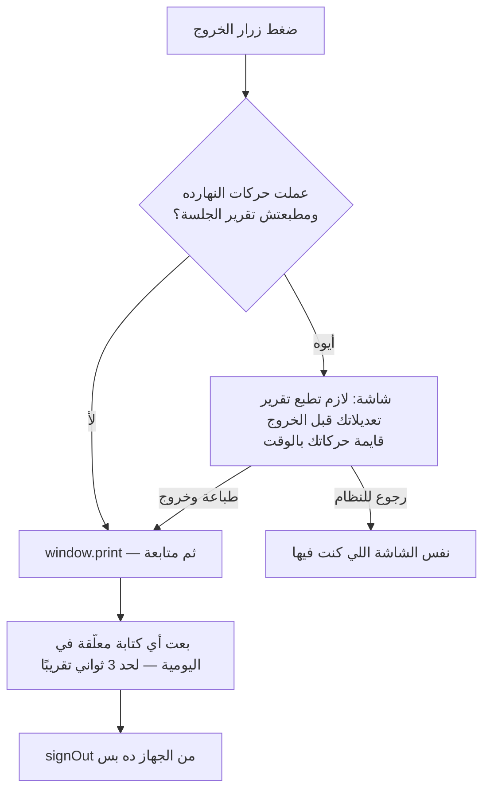

---

## 5) كل شاشة بالتفصيل

### 5.1 لوحة الغرف (`RoomBoard`)

**اللي بيظهر:**
- **بحث بكود النزيل** (3 حروف فأكتر): بيرجّع الغرفة اللي كان ساكن فيها حتى لو خرج.
- **4 مؤشرات:** تحصيل اليوم، مصاريف اليوم (مجموع الـ 3 شيفتات بعملتها)، نسبة الإشغال، عدد الشيفتات «تحتاج متابعة».
- **أقراص الحالات** وعددها، و**مربعات الغرف** (اسم الغرفة، النزيل، سعر الليلة، علامة «تسكين مكرر»).

**حالة الغرفة بتتحسب كده** (`computeRoomStatus`):

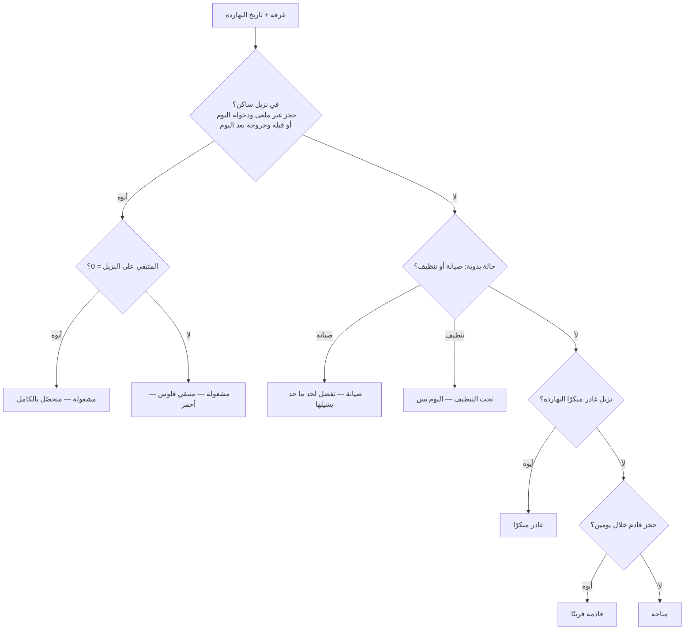

**بطاقة الغرفة (بالضغط على المربع):**

| الجزء | بيعمل إيه | مين ويشترط إيه |
|---|---|---|
| **كارت النزيل** | الاسم، التواريخ، الليالي، السعر، الأفراد، كود الحجز | الكل |
| **صندوق الفلوس (MoneyBox)** | الإجمالي، المدفوع، المتبقي، حالة الرد | الكل |
| **«اتدفع بـ»** | المدفوع مقسّم بالوسيلة وتفاصيلها (فيزا ****1234 / تحويل باسم ورقم) من اليومية | الكل |
| **طلب الرد (RefundBox)** | لو في طلب معلّق: الوسيلة الافتراضية = اللي عليها أكبر رصيد، تحذير لو اخترت وسيلة النزيل ماتدفعش بيها، زرار «رد الفلوس» و«رفض الرد (تأكيد)» | القرار لمدير الحجوزات بس |
| **تسجيل دفعة** | مبلغ (فاضي = كل المتبقي) + وسيلة + تفاصيلها ← «تسجيل التحصيل» | موظف الشيفت، شيفته شغال ومفتوح، والحجز مش ملغي وفيه متبقي |
| **غادر مبكرًا** | زرار بتأكيد بيعرض معاينة (هيتحاسب كام ليلة وهل هيتفتح رد) | نزيل ساكن، موظف أو مدير حجوزات |
| **تعديل الحجز** | بينقلك لتاب الحجوزات على نفس الحجز | مدير الحجوزات |
| **خدمات إضافية ودخول مبكر** (قسم مطوي) | رسوم: غسيل، كافيتيريا، جولات، بيك أب (مدير الحجوزات مايشوفش غسيل وكافيتيريا) ← «حفظ الرسوم». ورسم الدخول المبكر + «حصّلته دلوقتي» | الموظف والمدير؛ التحصيل للموظف فقط |
| **تمديد الإقامة** (قسم مطوي) | عدد ليالي إضافية ← «تمديد الحجز»؛ بيفحص إن الغرفة فاضية في الليالي دي | نزيل ساكن، موظف أو مدير |
| **أكواد الأفراد** | كود لكل فرد (فريد جوه الشهر) ← «حفظ الأكواد» | الموظف والمدير |
| **بيانات الحجز** | المصدر، آخر وسيلة دفع، تفاصيل التحويل/الفيزا، ملاحظات | الكل |
| **حالة الغرفة اليدوية** | «صيانة» / «تحت التنظيف» / «رجّع الحالة التلقائية» — **بس لما مفيش نزيل ساكن** | موظف في شيفته المفتوح، أو مدير الحجوزات |

لو الموظف **خارج شيفته** (مش وقته، أو الشيفت مقفول) بتظهر رسالة حمرا «مش شيفتك دلوقتي» أو «شيفتك مقفول» وكل أزرار الكتابة بتختفي.

### 5.2 الحجوزات (`BookingsPanel`)

**القايمة:** بحث (غرفة/اسم/كود حجز/كود فرد)، فلتر فترة (من/إلى)، فلتر الحالة (الكل / الشغّالة / الملغية)، طباعة القايمة، «حجز جديد» (لو الدور يقدر وفي شيفته). كل حجز بيظهر بيانات الدفع بالوسيلة وحالة الرد، وأزرار: تعديل، إلغاء بتأكيد (لمدير الحجوزات)، «تسجيل دفعة» (للموظف — لعربون على حجز بعيد).

**فورم الحجز** (جديد أو تعديل):
- الأساسي: الغرفة، اسم النزيل، الهاتف، عدد الأفراد، **تاريخ الدخول/الخروج** (الخروج لازم بعد الدخول)، **سعر الليلة** والعملة (EGP/USD/EUR/SAR/GBP)، إجمالي الغرفة (تلقائي = السعر × الليالي أو يدوي).
- خيارات إضافية (قسم مطوي): رسوم (غسيل، كافيتيريا، جولات، بيك أب)، دخول مبكر (رسم + ملاحظة)، جهة الحجز (مباشر/سوشيال ميديا/Booking.com/Expedia/Trip.com)، **مدفوع أونلاين** (سعر الغرفة اتدفع للمنصة وبتتحصل بس الخدمات)، ملاحظة المنصة، الحالة، ملاحظات.
- **كود الحجز** تلقائي (`B` + سنة/شهر + رقم: مثلًا `B2610-0001`).
- **أكواد الأفراد** (اختيارية): ممكن «املا الفاضي تلقائيًا».
- **دفعة مقدّمة** (حجز جديد، للموظف فقط): مبلغ + وسيلة + تفاصيل؛ بتتسجل بعد حفظ الحجز بالدالة الذرية.
- **تسكين مكرر:** لو الغرفة محجوزة في التواريخ دي، الفورم بيعرض الخطة قبل الحفظ (انظر السيناريو S7).
- **قفل مدير الحجوزات:** على حجز موجود السعر والرسوم والمدفوع بتتقفل في الواجهة؛ التواريخ بتتعدّل وإجمالي الغرفة بيتحرك تلقائيًا بنفس سعر الليلة.
- **تعارض تعديل:** لو الحجز اتعدّل من مكان تاني وانت فاتح الفورم، بيتعمل **دمج ثلاثي** (تعديلاتك + آخر نسخة) وبيطلب منك تراجع وتحفظ تاني.

### 5.3 اليومية (`DailyLedger`)

اليومية = **ورقة شيفت واحدة** (`shift_records`: تاريخ + نوع الشيفت). فيها كل فلوس الشيفت: تحصيل، مصاريف، عهدة.

**وضعين:**
1. **شيفتي النهارده** (للموظف فقط): اختيار الشيفت ثم الكتابة.
2. **استعراض شيفتات سابقة (قراءة فقط):** تاريخ + شيفت. مدير الحجوزات والمدير العام بيشوفوا هنا «إعادة فتح الشيفت» لو مقفول.

**اختيار الشيفت (`ShiftClaimPicker`):** 3 أزرار (صباحي ٨ص–٤م، مسائي ٤م–١٢ص، ليلي ١٢ص–٨ص). **بيتفتح بس الشيفت اللي وقته دلوقتي**، وأي شيفت حد أخده بيظهر «اتاخد بواسطة …». لو اتنين دوسوا في نفس اللحظة، واحد بس بينجح (قيد فريد في القاعدة).

**جدول الغرف:** صف لكل غرفة (بيظهر بس اللي فيه حركة؛ «أضف غرفة…» و«عرض كل الغرف»). كل صف: **مصروف** (بند، بيان، مبلغ، عملة) و**تحصيل** (وسيلة، بيان، مبلغ، عملة، تفاصيل الدفع، ملاحظات). نفس الغرفة ممكن يبقى ليها أكتر من صف (وسيلة/عملة مختلفة، أو رد).

**الأقسام:**
- **الكافيتيريا:** مبيعات ومصاريف مباشرة؛ تحصيل خدمات النزلاء (تلقائي)؛ خدمات نزلاء لسه عليها فلوس؛ **كافيتيريا الاستاف** (استهلاك آجل أو مدفوع، وسداد مديونيات).
- **مصاريف وإيرادات الفندق:** بنود مش مرتبطة بغرفة (كهرباء، قاعة…) وتقدر تضيف وتشيل بنود.
- **متابعة الشيفت:** علامة «يحتاج متابعة» وملاحظات.
- **الملخص:** العهدة (كاش) لكل عملة، وعهدة وسائل الدفع الأخرى (قراءة جهاز الفيزا مثلًا)، وكل عمليات الوسيلة بتفاصيلها، ورصيد الإقفال المحسوب.

**الحفظ التلقائي:** كل تعديل بيظهر فورًا ويتبعت للسيرفر بعد 0.7 ثانية من آخر كتابة (مرة واحدة)، ولو فشل بيعيد كل 5 ثواني (6 محاولات) ومش بيضيع. لو حد عدّل نفس الورقة (رد فلوس مثلًا) بيتعمل **دمج** بين اللي كتبته واللي نزل.

**الإقفال:** زرار «إقفال الشيفت» — **بيرفض** لو في تحصيل فيزا من غير آخر 4 أرقام أو تحويل من غير رقم. بعد الإقفال بتتحفظ الإجماليات (إجمالي تحصيل، مصاريف، كاش، رصيد الخزينة، رصيد كل وسيلة)، والورقة تتقفل.

**الأوفر تايم والإقفال التلقائي:**

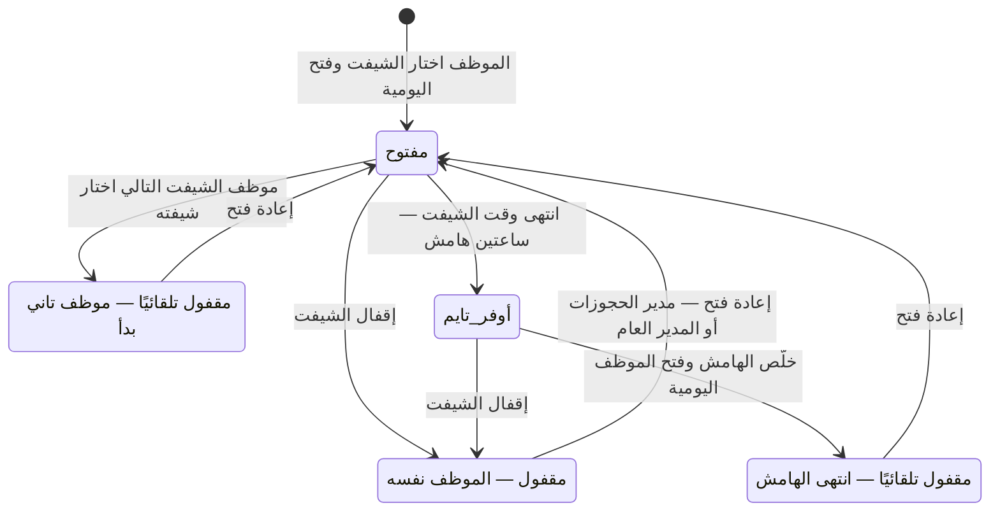

- **عهدة الشيفت اللي قبله:** بتتنقل تلقائيًا من رصيد إقفال أقرب شيفت مقفول (لحد 3 شيفتات لورا). لو الشيفت اللي قبله لسه مفتوح، بيتقفل تلقائيًا أول ما الجديد يبدأ.
- **إعادة فتح شيفت بعد انتهاء وقته** بتنجح، لكن بيتقفل تاني تلقائيًا أول ما الموظف يفتح اليومية (والرسالة بتقول كده بصراحة).

### 5.4 التقارير (`ReportsPanel`)

اختيار **يوم واحد** أو **فترة** (حد أقصى 366 يوم). بتتجمع من كل ورقات الشيفتات في الفترة (المقفولة بإجمالياتها المحفوظة، والمفتوحة محسوبة لايف):
- **إجمالي التحصيل، إجمالي المصاريف، صافي التحصيل، متوسط الإشغال.**
- **التحصيل حسب الوسيلة والعملة**، و**المصاريف حسب البند**.
- **تفاصيل عمليات الفيزا والتحويلات** (كل عملية بكارتها/رقمها).
- **متابعة عهدة** (كانت قبل + حصلت في الفترة = الإجمالي دلوقتي) للكاش وكل وسيلة.
- **الكافيتيريا** (مبيعات مباشرة، تحصيل نزلاء، سداد استاف) و**استاف عليهم فلوس** (رصيد حالي).
- **حجوزات أونلاين** (إجمالي إيراد المنصة بشكل منفصل).
- **تحصيل حجوزات مباشر مش متسجّل في يومية** (بيانات قديمة) — من غير تكرار لما يكون اتسجل في يومية.
- **شيفتات فيها ملاحظات متابعة.**
- زرار **نسخ ملخص** (للحافظة) وزرار **طباعة**. لو القراءة فشلت بيظهر تحذير `report-load-warning` بدل أرقام ناقصة بصمت.

### 5.5 سجل الحركة (`ActivityPanel`)

آخر **300** حركة: اسم المستخدم ودوره والعبارة والوقت. بيتكتب من الواجهة بعد كل عملية (حجز، دفعة، رد، إقفال…). القاعدة بتحط **هوية الفاعل والوقت** بنفسها (مينفعش تتزوّر)، لكن **الكتابة نفسها من الواجهة** — عشان كده فيه كمان سجل تدقيق على مستوى القاعدة (`money_audit`، انظر دليل القاعدة).

### 5.6 إدارة المستخدمين (`UsersPanel`)

- **للمدير العام فقط:** «مستخدم جديد» (الاسم، اسم المستخدم، الدور، كلمة المرور) ← Edge Function `create-user`؛ «إعادة تعيين كلمة المرور» ← `reset-password`؛ «تعطيل/تفعيل» (بتأكيد)؛ **شيفتات النهارده:** إلغاء اختيار شيفت غلط (بيمسح ورقة اليومية بتاعته بتأكيد، ورافض لو مقفولة).
- **بقية الأدوار:** قايمة المستخدمين للعرض بس.
- **حمايات:** مينفعش تعطّل نفسك، ولازم يفضل مدير عام فعّال واحد على الأقل (في الواجهة **وفي القاعدة** بـ trigger).

---

## 6) السيناريوهات من الأول للآخر

> **اصطلاح:** «القاعدة» = اللي بيتكتب فعلًا. أسماء الدوال والجداول بالإنجليزي.

### S1 — يوم موظف الشيفت (من الدخول للإقفال)

1. يفتح الموقع ← يدخل ← تاب «لوحة الغرف».
2. تاب «اليومية» ← يختار شيفته ← **القاعدة:** صف `shift_claims` + (عند فتح اليومية) صف `shift_records` بالعهدة المنقولة.
3. يشتغل: حجوزات، دفعات، رسوم، كافيتيريا، مصاريف… (السيناريوهات تحت).
4. في آخر الشيفت: يراجع عهدته ← «إقفال الشيفت».
5. الخروج: لازم يطبع «تقرير الجلسة» (لو عمل حركات).

### S2 — حجز جديد (بدون دفع)

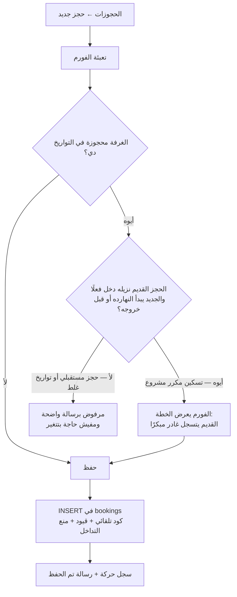

**القاعدة:** `bookings` (الكود تلقائي، `amount_paid = 0`، `settled` محسوبة)، و`booking_guests` لو في أكواد أفراد، و`money_audit` فقط لو المدفوع ≠ 0 (مش هنا).

### S3 — دفعة (كاش / فيزا / تحويل / جزئية)

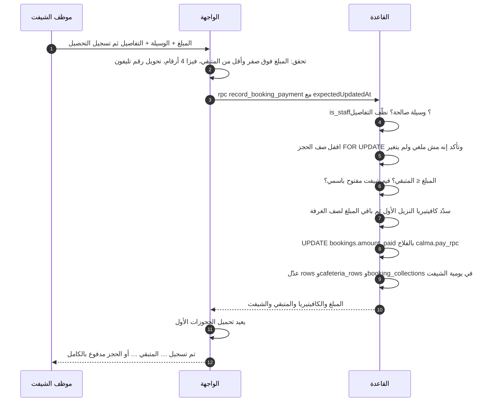

- **كله أو ولا حاجة:** لو أي خطوة فشلت ماتتسجلش حاجة (لا على الحجز ولا في اليومية).
- **ضغطة مزدوجة:** الواجهة بتمنع نفس العملية تتنفذ مرتين (`guarded`)، و`p_expected` بيمنع إعادة نفس الدفعة لو الرد ضاع.
- **قطع النت أثناء الدفع:** لو مفيش رد، الرسالة بتقول «مش متأكدين إن العملية اتسجّلت — راجع المدفوع قبل ما تعيد».
- **الحالة التلقائية:** `settled` بتتحسب لوحدها = غير ملغي **و** المدفوع ≥ إجمالي الفندق. مفيش علامة «متحصّل» يدوية.

### S4 — تمديد الإقامة

الموظف/المدير: «عدد الليالي» ← «تمديد الحجز». الواجهة بتفحص إن الغرفة فاضية، وبتحسب الإجمالي الجديد = الحالي + سعر الليلة × الليالي. **القاعدة** بترفض لو إجمالي الغرفة مش متطابق مع التمديد (مفيش تمديد مجاني)، وتمنع التداخل. الغرفة بتبقى حمراء لحد ما يتحصّل الفرق.

### S5 — دخول مبكر

«رسم الدخول المبكر» (+ملاحظة، + «حصّلته دلوقتي» بوسيلة): الرسم بيتضاف على الحجز ويزوّد المتبقي (مرة واحدة فقط على الحجز)، وبعدين لو «حصّلته» بيتسجل بدفعة ذرية بنفس الطريقة (S3).

### S6 — غادر مبكرًا

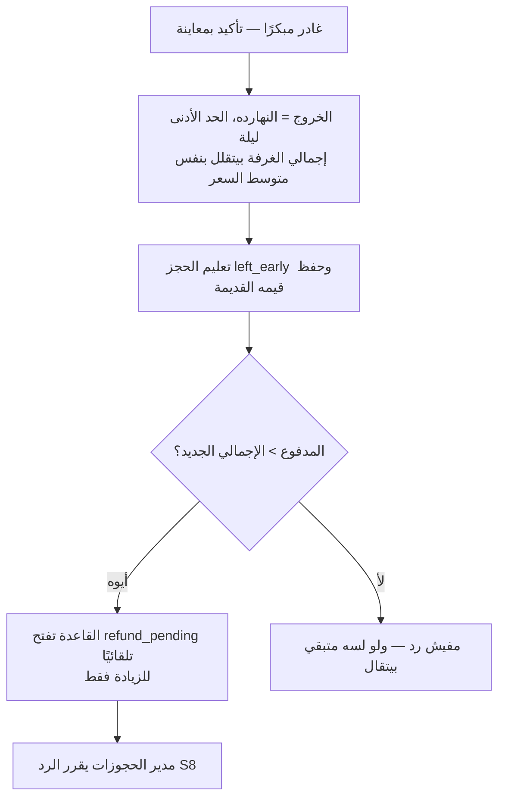

الموظف مسموحله بس لنزيل **بدأ إقامته فعلًا**؛ حجز مستقبلي إلغاؤه من مدير الحجوزات.

### S7 — تسكين مكرر

نزيل جديد على غرفة لسه عليها نزيل قديم دخل فعلًا: الحفظ بيسجّل القديم «غادر مبكرًا» (مش «ملغي») ويتحاسب على اللي قعده، والجديد يتعلّم «تسكين مكرر». لو حفظ الجديد فشل، **التسكين بيتراجع تلقائيًا**. لو الحجز القديم مستقبلي أو التواريخ غلط: مرفوض بسبب واضح.

### S8 — إلغاء حجز ورد الفلوس

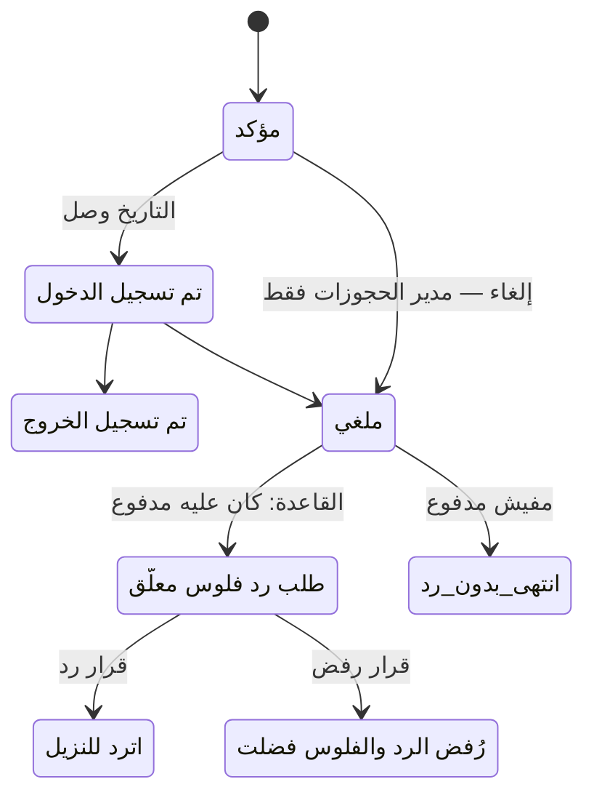

**القرار** (`decide_booking_refund`، مدير الحجوزات فقط):
1. يتحقق إن في طلب معلّق فعلًا (مرتين = «اتقرر قبل كده»).
2. «رفض»: بيقفل الطلب، الفلوس فاضلة، الحجز يفضل ظاهر.
3. «رد»: بيحسب المبلغ (حجز ملغي: كل المدفوع؛ غيره: الزيادة عن الإجمالي)، وبيوزّعه على **وسائل الدفع الأصلية** (الوسيلة اللي اخترتها الأول وبعدها الأكبر رصيد) من واقع اليومية، ويسجله **بالسالب** في صفوف نفس الحجز في أول يومية شيفت **مفتوح** (لازم يكون في شيفت مفتوح، وإلا الرسالة: «مفيش شيفت مفتوح دلوقتي»).
4. بيخصم `amount_paid` ويكتب `refunded_amount/by/at` و`refund_decision = refunded`.
5. الرسالة بتقول لموظف الاستقبال **يسلّم النزيل كام بكل وسيلة**.

### S9 — كافيتيريا النزيل

الرسوم «كافيتيريا» على الحجز بتتحدد من بطاقة الغرفة أو فورم الحجز. أي دفعة بعدها بتسدّد الكافيتيريا **الأول** وبتروح لصف «كافيتيريا» في اليومية (ومتابعة `extras.cafeteriaPaid`). مفيش تعديل يدوي على `cafeteriaPaid` (محمي بـ trigger).

### S10 — كافيتيريا الاستاف

- **استهلاك:** اختيار موظف (أو كتابة اسم) + بيان + مبلغ + عملة + «دفع الآن/آجل» ← `record_staff_cafeteria`. لو آجل: مديونية في `staff_cafeteria` (مفيش صف في اليومية). لو دفع: بيتسجل كمان في صف الكافيتيريا.
- **سداد:** من قايمة «استاف عليهم فلوس» ← المبلغ (≤ المديونية) + الوسيلة ← `settle_staff_cafeteria`: بيوزّع على **أقدم** استهلاك الأول وبيسجل في اليومية. القاعدة بتقفل الصفوف عشان سداد متزامن من موظفين مايعديش المبلغ.
- مفيش تعديل مباشر على المبلغ/المدفوع (قفل في القاعدة).

### S11 — تبديل الشيفتات والأوفر تايم

الموظف التالي يختار شيفته ← الشيفت اللي قبله بيتقفل تلقائيًا (لو مفتوح) وعهدته بتنتقل. لو محدش اختار، الشيفت يفضل «أوفر تايم» ساعتين بعد وقته، وبعدها بيتقفل تلقائيًا أول ما صاحبه (أو أي حد) يفتح اليومية.

### S12 — إعادة فتح شيفت مقفول

مدير الحجوزات أو المدير العام: اليومية ← استعراض ← التاريخ/الشيفت ← «إعادة فتح الشيفت». القاعدة بتسمح بإعادة الفتح **من غير تغيير المحتوى**؛ أي تصحيح للأرقام وهو مقفول من المدير العام/الحسابات فقط (من SQL/API).

### S13 — المستخدمين

إنشاء: Edge Function تعمل حساب الدخول والبروفايل (ولو البروفايل فشل بتمسح الحساب اليتيم). إيقاف: الحساب بيتوقف **فورًا** حتى لو معاه جلسة شغالة (الصلاحيات بتتقرا من القاعدة في كل طلب). **إعادة الباسورد مابتقفلش الجلسات القديمة** — عطّل الحساب كمان لو الموظف مشي.

### S14 — تغيير حالة الغرفة (صيانة/تنظيف)

الموظف (في شيفته) أو مدير الحجوزات: بطاقة الغرفة (فاضية) ← «صيانة» (تفضل) أو «تحت التنظيف» (اليوم بس) أو «رجّع الحالة التلقائية». القاعدة بتحط اسم الفاعل والوقت بنفسها.

### S15 — تقرير فترة / طباعة

التقارير ← «فترة» ← من/إلى ← الأرقام ← «طباعة» (ترويسة فيها اسم الفندق والتاريخ، وتوقيع/ختم) أو «نسخ ملخص».

---

## 7) الحسابات والقواعد المالية

| الشيء | المعادلة | المصدر |
|---|---|---|
| إجمالي الحجز | إجمالي الغرفة + غسيل + كافيتيريا + جولات + بيك أب + رسم الدخول المبكر (لو اتطبّق) | `booking_grand_total` |
| إجمالي الفندق | الإجمالي، إلا لو **مدفوع أونلاين**: الإجمالي − إجمالي الغرفة | `booking_hotel_total` |
| المتبقي | `max(0, إجمالي الفندق − المدفوع)` | واجهة + قاعدة |
| متحصّل بالكامل | غير ملغي **و** المدفوع ≥ إجمالي الفندق | `bookings_auto_settled` |
| تعديل الإجمالي بتغيير التاريخ | الحد الأدنى ليلة؛ تمديد: + سعر الليلة × الليالي؛ تقصير: الإجمالي × (ليالي القعاد ÷ المحجوزة) | `reprice_total` |
| مبلغ الرد | ملغي: كل المدفوع؛ غير كده: `المدفوع − الإجمالي` | `decide_booking_refund` |
| رصيد الخزينة (كاش) لعملة | عهدة + تحصيل الكاش − المصاريف | `computeShiftTotals` |
| رصيد وسيلة غير الكاش | عهدة (قراءة الجهاز) + المتحصّل بنفس الوسيلة والعملة | `computeShiftTotals` |
| تقريب | كل المبالغ لقرشين | واجهة وقاعدة |

**قواعد ثابتة:**
- الفلوس **ما بتتجمعش عبر عملات**: كل عملة لوحدها في كل مكان.
- صف التحصيل الواحد له **وسيلة وعملة واحدة**؛ مفيش خلط كاش وفيزا في صف.
- **فيزا** لازم آخر 4 أرقام (والتفاصيل بتتنظف لـ 4 أرقام بس). **التحويل/فودافون/انستاباي** لازم رقم تليفون (6 أرقام فأكتر) واسم اختياري.
- المدفوع **مش بيتعدّل بإيد**: من أي مستخدم حقيقي بيتغيّر بالدالتين `record_booking_payment` و`decide_booking_refund` بس.
- العملات: EGP / USD / EUR / SAR / GBP. وسائل الدفع: كاش، فيزا، تحويل بنكي / انستاباي، فودافون كاش.
- بنود المصاريف: كهرباء ومياه، مشتريات ومطبخ، صيانة، مرتبات وحوافز، نظافة، أخرى.

---

## 8) المزامنة والشبكة والأعطال

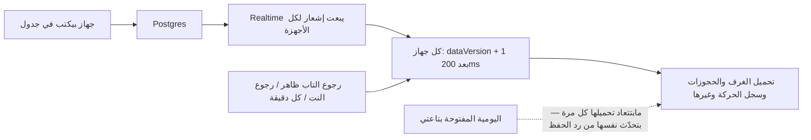

- **الاشتراك اللحظي** بعد الدخول بس (جلسة المستخدم الحقيقية)، + احتياطي كل دقيقة، + عند رجوع النت أو ظهور التاب.
- **تعارض كتابة:** الحجوزات واليوميات بتتحدّث بشرط `updated_at` — لو حد غيّرها في نفس اللحظة تظهر رسالة تعارض وتتحدّث البيانات بدل ما تكتب فوقه.
- **قطع النت:** اليومية بتحتفظ بالتعديلات وتعيد المحاولة؛ قبل إغلاق التاب بيحذّرك المتصفح؛ وقبل الخروج بيتبعتوا. عمليات الفلوس بتبلّغ لو مش متأكدة.
- **التحديث التلقائي للتطبيق:** بيفحص كل دقيقة، ولو في نسخة جديدة بيطبّقها **بس لو مفيش فورم مفتوح ولا كتابة معلّقة**.
- **خطأ برمجي غير متوقع:** شاشة «حصل خطأ غير متوقع — تحديث الصفحة» بدل شاشة بيضا.

---

## 9) رسائل الخطأ الشائعة

| الرسالة | السبب | الحل |
|---|---|---|
| قاعدة البيانات لسه ماتحدّثتش لآخر نسخة | `schema.sql` مش متطبق أو أقدم من 37 | شغّل `schema.sql` كامل على Supabase |
| مفيش شيفتك مفتوح - التحصيل لازم يتسجّل في يومية شيفتك | مفيش صف شيفت مفتوح باسمك | اختار شيفتك وافتح اليومية |
| المبلغ أكبر من المتبقي على النزيل | الدفعة > المتبقي | اكتب مبلغ أقل أو سيبه فاضي |
| اكتب آخر ٤ أرقام من الكارت / اكتب رقم التليفون اللي اتحوّل منه | تفاصيل الوسيلة ناقصة | كمّلها |
| الحجز اتغيّر من حد تاني - حدّث الصفحة | نسخة الحجز اللي قدامك قديمة | حدّث وراجع |
| المدفوع على الحجز بيتغيّر من تسجيل دفعة أو قرار رد الفلوس بس | محاولة تعديل `amount_paid` مباشرة | استخدم «تسجيل دفعة» |
| الحجز ده عليه حركة فلوس … استخدم حالة «ملغي» بدل الحذف | محاولة حذف حجز عليه فلوس | الغي الحجز |
| الغرفة دي اتحجزت لحد تاني في تواريخ متداخلة | تداخل حجوزات | غيّر الغرفة/التواريخ |
| إلغاء الحجز (ملغي) من صلاحية مدير الحجوزات بس | موظف حاول يلغي | اطلب من مدير الحجوزات |
| قرار رد الفلوس من صلاحية مدير الحجوزات بس | غير مدير حجوزات حاول يقرر | مدير الحجوزات |
| مفيش شيفت مفتوح دلوقتي في اليومية - الرد بيتسجّل في يومية شيفت مفتوح | قرار رد من غير أي شيفت مفتوح | استنى موظف يفتح شيفته |
| مينفعش تقفل الشيفت: … من غير آخر ٤ أرقام | تحصيل فيزا/تحويل من غير تفاصيل | كمّل التفاصيل ثم أقفل |
| إعادة فتح شيفت مقفول من صلاحية المدير العام أو مدير الحجوزات بس | محاولة من دور تاني | اطلب منهم |
| الكود … مستخدم الشهر ده بالفعل | كود فرد مكرر في الشهر | اختار كود تاني |
| لازم يفضل مدير عام واحد فعّال على الأقل | محاولة تعطيل آخر مدير عام | فعّل مدير تاني الأول |
| مش شيفتك دلوقتي / شيفتك مقفول | موظف خارج وقته أو بعد الإقفال | افتح الشيفت (إعادة فتح) أو انتظر شيفتك |

---

## 10) حدود معروفة

(من `HANDOVER.md` القسم 6 وشهادة الجاهزية.)

- **وقت الشيفت بتفحصه الواجهة بساعة الجهاز**، مش القاعدة (القاعدة تفحص وجود شيفت مفتوح فقط). ساعة جهاز غلط تأثّر على قرارات الأوفر تايم.
- **الإقفال التلقائي بيتنفذ من متصفح مستخدم** مش من سيرفر مجدول: لو محدش فتح التطبيق، الشيفت يفضل مفتوح.
- **مدير الحجوزات** بيحدد السعر وبيقرر الرد معًا، وقفل السعر بعد الحفظ في الواجهة فقط.
- **الرد** بيتسجل على أحدث شيفت مفتوح لأي موظف من غير فحص كاش الدرج، وبيتعطل لو مفيش شيفت مفتوح.
- **كافيتيريا الاستاف:** لو الرد ضاع بعد نجاح العملية وأعاد الموظف، ممكن يتكرر الاستهلاك (مفيش مفتاح تكرار).
- **إعادة تعيين الباسورد** ما بتلغيش الجلسات؛ عطّل الحساب.
- **التسجيل العام** في Supabase لازم يتقفل من لوحة Supabase.
- `src/domain/importLogic.js` (استيراد حجوزات) **موجود في الكود ومش متوصل بأي شاشة**.

---

## 11) ملحق: ضغطة ← طلب ← جدول

| الضغطة / الشاشة | الدالة في `src/` | الطلب | بيكتب/بيقرا |
|---|---|---|---|
| دخول | `lib/auth.signIn` | Auth `signInWithPassword` | — |
| الإعداد الأول | `signUpUser` | Auth `signUp` + insert `profiles` | `profiles` |
| تحميل أول | `App` | select `rooms`, `room_overrides`, `bookings` (صفحات), `activity_log` | قراءة |
| فحص النسخة | `schemaCheck.checkSchemaVersion` | rpc `calma_schema_version` | — |
| حجز جديد / تعديل | `data/bookings.insertBooking / updateBookingIfUnchanged` | insert / update `bookings` | `bookings`, `booking_guests`, `money_audit` |
| إلغاء حجز | `BookingsPanel.cancelBooking` | update `bookings.status` | `bookings` (+ `refund_pending`) |
| تسجيل دفعة | `data/payments.recordBookingPayment` | rpc `record_booking_payment` | `bookings`, `shift_records` |
| قرار الرد | `data/bookings.decideBookingRefund` | rpc `decide_booking_refund` | `bookings`, `shift_records` |
| حالة غرفة | `data/rooms.setRoomOverride` | upsert `room_overrides` | `room_overrides` |
| اختيار شيفت | `data/shifts.claimShiftRow` | insert `shift_claims` | `shift_claims` |
| فتح اليومية | `createShiftRecord` | insert `shift_records` | `shift_records` |
| حفظ اليومية | `updateShiftRecordIfUnchanged` | update `shift_records` | `shift_records` |
| إقفال/إعادة فتح | نفسها (closed true/false) | update `shift_records` | `shift_records`, `money_audit` |
| استهلاك استاف | `recordStaffCafeteria` | rpc `record_staff_cafeteria` | `staff_cafeteria`, `shift_records` |
| سداد استاف | `settleStaffCafeteria` | rpc `settle_staff_cafeteria` | `staff_cafeteria`, `shift_records` |
| سجل حركة | `data/activity.addActivity` | insert `activity_log` | `activity_log` |
| إنشاء مستخدم | `auth.adminCreateUser` | Edge Function `create-user` | `auth.users`, `profiles` |
| إعادة باسورد | `auth.adminResetPassword` | Edge Function `reset-password` | `auth.users` |
| تعطيل/تفعيل | `auth.setProfileActive` | update `profiles.active` | `profiles`, `money_audit` |
| إلغاء اختيار شيفت | `shifts.deleteShiftRecord` + `clearClaimRow` | delete `shift_records` + `shift_claims` | الاتنين |
| التقارير | `getShiftRecordsInRange`, `getJournaledBookingIds`, `listStaffCafeteria` | select | قراءة |
